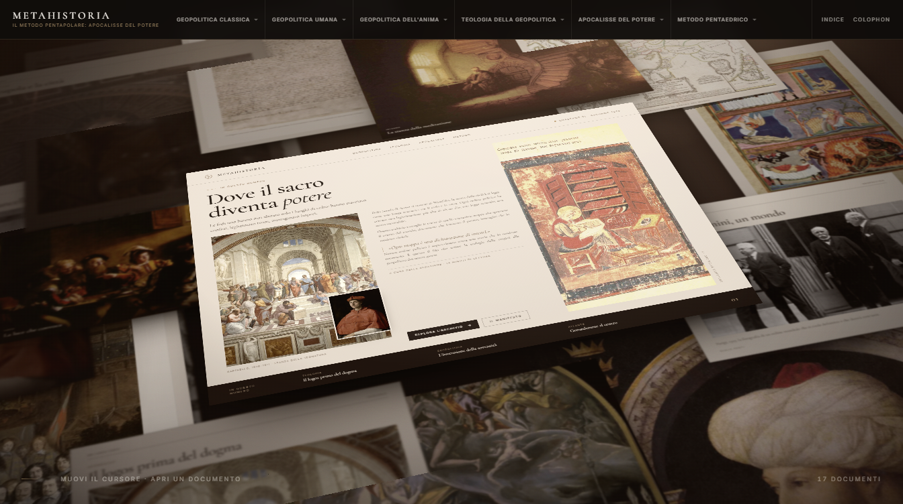
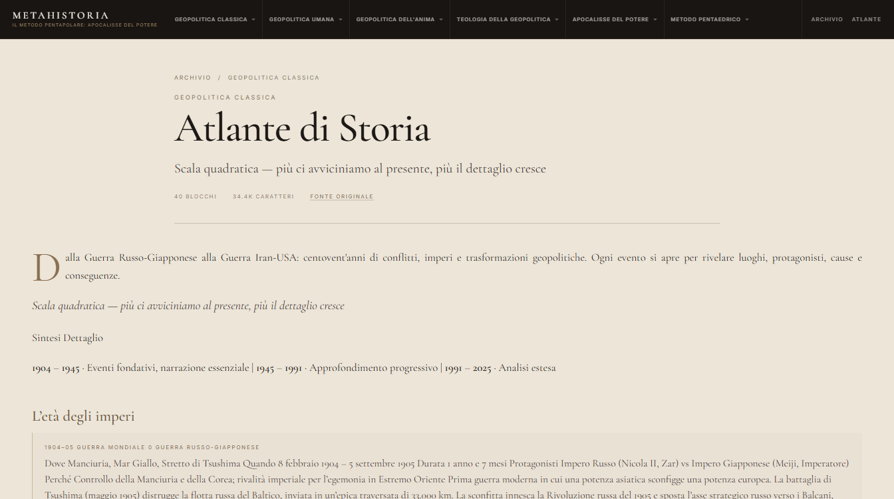
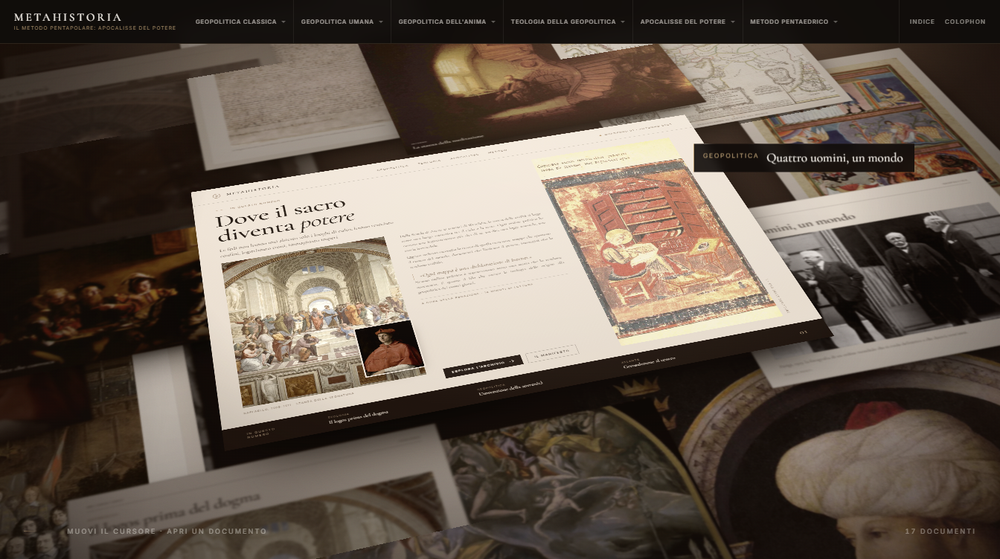
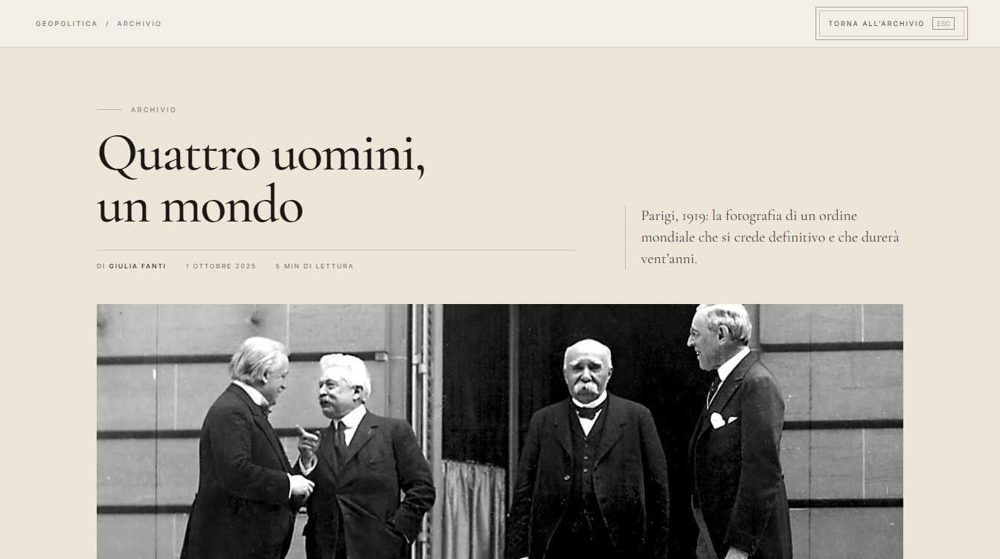
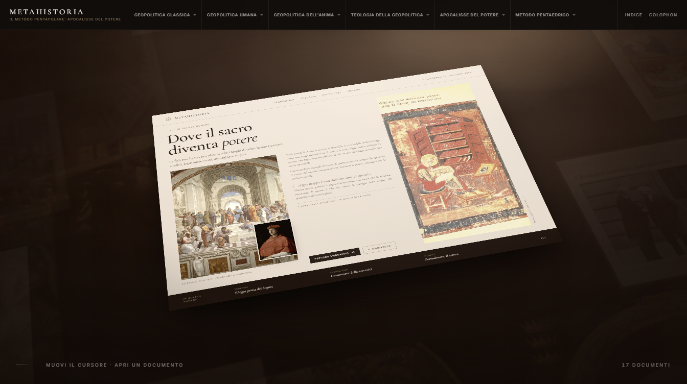
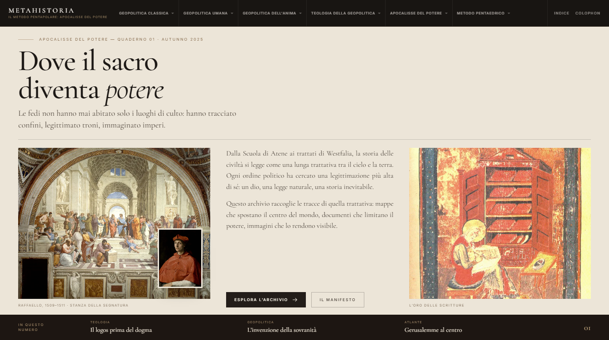
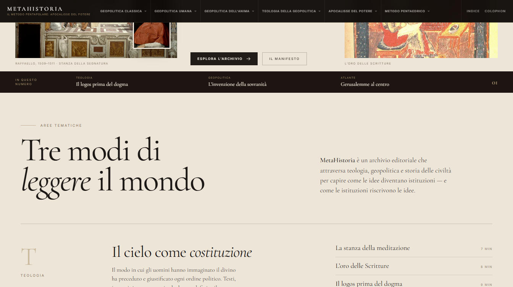

# MetaHistoria — homepage

Homepage editoriale cinematografica per **MetaHistoria — Il Metodo Pentapolare: Apocalisse del
Potere**, un sito di teologia, geopolitica e storia delle civiltà.
L'archivio tridimensionale di `template.png` è ricostruito in CSS 3D + GSAP, con la pagina
protagonista in HTML reale (non una texture). In testata il menu a tendina a sei sezioni; allo
scroll la pagina bianca si raddrizza, prende tutto lo schermo e diventa leggibile.



---

## Avvio

```bash
npm install
npm run dev      # http://127.0.0.1:5173
```

Build di produzione:

```bash
npm run build
npm run preview  # http://127.0.0.1:4173
```

Requisiti: Node 20+. Nessun servizio esterno: immagini e font sono serviti localmente.

### Scorciatoie di sviluppo

| URL | Cosa fa |
|---|---|
| `/` | esperienza completa |
| `/?flat` | isola la pagina protagonista di fronte, a scala 1 — serve a lavorare sull'impaginato |

---

## Stack e decisione architetturale

React 19 + TypeScript + Vite, GSAP 3 con ScrollTrigger, CSS 3D.

**Three.js non è stato usato, ed è una scelta.** La scena richiesta è composta da superfici
piane (carte, dipinti, documenti) disposte su un tavolo inclinato. Le trasformazioni 3D del DOM
danno già:

- prospettiva reale (`perspective` + `preserve-3d` + `translate3d`/`rotate` per ogni carta);
- ordinamento in profondità corretto tra le carte;
- hit-testing nativo: hover, focus da tastiera e click funzionano sulle superfici inclinate;
- testo perfettamente nitido sulla pagina protagonista, che resta HTML vero anche da vicino.

Un renderer WebGL avrebbe richiesto una texture per la pagina centrale (testo sfocato, nessuna
selezione, nessun link accessibile) e una sincronizzazione DOM/scena per le transizioni. Il
risultato visivo sarebbe stato identico con più codice e più failure mode. GSAP regge tutta la
regia: intro, parallasse, hover, transizione al lettore, sequenza di scroll.

Separazione dei compiti:

| Livello | Dove | Responsabilità |
|---|---|---|
| Composizione | `src/data/documents.ts` | posizione, rotazione, scala, ombra, sfocatura di ogni documento |
| Contenuti | `src/data/documents.ts`, `src/data/media.json` | testi, rubriche, articoli, mappa immagini |
| Rendering | `Paper.tsx`, `HeroPage.tsx` | superfici, varianti tipografiche, miniatura editoriale |
| Motion | `Scene.tsx` + CSS | un solo ticker scrive i transform di camera e tavolo |

---

## Struttura

```
src/
  App.tsx                  guscio di routing: testata + homepage oppure pagina
  lib/router.tsx           router minimo su history API, Link, useRoute
  content/
    manifest.json          indice delle 131 pagine migrate (hash, conteggi, percorso)
    navigation.json        6 gruppi, 49 voci, alias
    pages/*.json           131 documenti a blocchi tipizzati
    content.ts             caricamento lazy, alberatura, etichette
  components/
    Home.tsx               la homepage cinematografica (invariata)
    Scene.tsx              scena 3D: camera, tavolo, carte, intro, hover, scroll
    Paper.tsx              singolo documento + 5 varianti (page/plate/map/document/manuscript)
    HeroPage.tsx           la homepage in miniatura (1200×870) dentro l'archivio
    Sheet.tsx              la stessa pagina a tutto schermo, leggibile
    Masthead.tsx           testata fissa + menu a tendina a sei sezioni
    EditorialPage.tsx      pagina editoriale: testata, blocchi, indice, riferimenti, capitoli
    BlockRenderer.tsx      renderer dei blocchi (nessun HTML grezzo)
    PageRoute.tsx          risoluzione rotta + 404
    Reader.tsx             anteprima articolo con transizione FLIP
    Editorial.tsx          area tematica + colophon
  data/
    site.ts                nome, sottotitolo e albero del menu
    documents.ts           17 documenti dell'archivio: coordinate, copy, articoli
    assets.json            metadati Wikimedia (autore, licenza, pagina sorgente)
    media.json             dimensioni e peso delle immagini ottimizzate
  styles/
    base.css               token, tipografia, reset
    masthead.css           testata e pannelli del menu
    scene.css              prospettiva, carte, atmosfera
    hero-page.css          impaginato della miniatura
    sheet.css              impaginato del foglio a tutto schermo
    article.css            pagine editoriali migrate
    reader.css             lettore
    editorial.css          sezione finale
scripts/
  fetch-assets.mjs         scarica da Commons e verifica la licenza
  optimize_assets.py       WebP, lato lungo 1100px
  contact_sheet.py         foglio di contatto per il controllo visivo
migration/                 crawler, estrattore, validatore, test delle route
assets-src/                originali scaricati (fuori da public, non serviti, ignorati da git)
```

---

## Contenuti migrati

Il sito pubblico `https://precious-cassata-42205a.netlify.app/` è stato acquisito integralmente:

| | |
|---|---|
| Pagine sorgente | 131 (137 URL scoperti, 6 link rotti sul sorgente) |
| Route locali | 126 + 9 alias |
| Blocchi tipizzati | 8.984 |
| Testo | 2.215.465 caratteri (~369.000 parole) |
| Voci di menu | 49, su 6 sezioni gerarchiche |
| Completezza verificata | **10.681 unità testuali, 0 mancanti (100%)** |

Ogni pagina ha la sua route, la sua testata, i riferimenti, l'indice di sezione e i capitoli
precedente/successivo. Il rendering non usa HTML grezzo: i contenuti sono blocchi tipizzati
(`h`, `p`, `list`, `quote`, `table`, `card`) con grassetti e corsivi preservati come segmenti.

Dettaglio completo, metodo di verifica e limiti: **[`docs/MIGRAZIONE.md`](docs/MIGRAZIONE.md)**.



---

## La composizione

La scena è un sistema di coordinate in pixel di progetto su base **1344×752** (la misura della
reference). Tutto scala uniformemente con `--s`, quindi la composizione non si deforma mai.

```
stage → stage__scale (scale) → stage__roll (rollio di camera) → scene (perspective 1900px)
      → camera (parallasse) → world (rotateX 52°) → anchor-base (x,y,z)
      → paper-move (rz, rx) → paper (scala, centro)
```

Il tavolo è inclinato di **52°** sull'asse X: una carta alta 870 px appare alta
`870 × cos 52° ≈ 535 px`, più la rotazione in piano. Il rollio di camera di **-3.4°** porta le
basi dei testi a circa -10°, come nella reference.

Posizioni, rotazioni, ombre e sfocatura sono **deterministiche**: nessun valore casuale, nessuna
variazione tra un caricamento e l'altro. Per ricalibrare la scena si modificano solo i campi
`layout` e `shade` in `documents.ts`.

Ogni documento ha la sua profondità `z` (le carte sopra le altre), la sua ombra di contatto e una
`filter: blur()` crescente verso i bordi: è la profondità di campo che rende la scena fotografica
invece che vettoriale.

---

## Le cinque animazioni

**A — Intro** (2.6 s). Camera da `z −820` a `0` con `power2.out`; il tavolo passa da 58° a 52°;
il rollio si assesta da -5.6° a -3.4°; le carte entrano da `opacity 0` con uno stagger che parte dal
centro; la luce centrale sale da 0.4 a 1. L'ultimo fotogramma coincide con la composizione statica.


**B — Parallasse.** `pointermove` → quattro `gsap.quickTo` su un oggetto di stato (rotazione X/Y e
traslazione della camera, 1.15–1.25 s, `power3.out`). Le carte lontane si muovono meno di quelle
vicine per costruzione prospettica, non per compensazione artificiale.

**C — Hover.** La carta sale di 30 px sul proprio asse Z, si ingrandisce del 4.5% e l'ombra si
schiarisce. L'etichetta editoriale è in spazio schermo (`position: fixed`), quindi resta leggibile
anche su una superficie inclinata di 52°.



**D — Click.** Il lettore entra con una transizione **FLIP**: parte dal rettangolo reale della carta
(`scale 0.42, translate 389, 23`) e arriva a schermo pieno in 0.78 s (`power3.inOut`), mentre la
scena trattiene il respiro. Nessun video, nessuna nuova rotta, nessun refresh. `Esc` o "Torna
all'archivio" chiudono con la transizione inversa.



**E — Scroll** (5 fasi, `pin` + `scrub: 0.7`, 165% di viewport):

1. la camera avanza nel tavolo;
2. le carte periferiche si aprono in un corridoio e si spengono a `opacity 0.08`;
3. la pagina protagonista si raddrizza (`worldTilt → 0`, `rz → 0`, rollio → 0) e viene avanti;
4. la pagina riempie il viewport, l'atmosfera si azzera e il contenuto in miniatura sfuma;
5. il **foglio leggibile** (`Sheet.tsx`) prende il posto della pagina: stessa impaginazione, ma
   composta per essere letta a tutto schermo. Resta impresso, e scorrendo ancora è lui a uscire
   dallo schermo mentre entrano le aree tematiche — stessa carta avorio, cucitura invisibile.





La sequenza è reversibile: lo scrub riavvolge tutto e riporta le carte al loro posto.

---

## Contenuti

Testata **MetaHistoria** con il sottotitolo *Il Metodo Pentapolare: Apocalisse del Potere* e un
menu a tendina a sei sezioni — Geopolitica classica, Geopolitica umana, Geopolitica dell'anima,
Teologia della geopolitica, Apocalisse del potere, Metodo pentaedrico — ciascuna con il proprio
elenco di voci, come da riferimento.

Nel foglio: sezione **Teologia**, **Geopolitica**, **Storia** e **Atlante**; 17 documenti fra
dipinti rinascimentali, mappe storiche, manoscritti miniati, documenti diplomatici, fotografie
d'archivio e architetture. Ogni documento ha rubrica, titolo, sommario e un articolo di due
paragrafi che si apre nel lettore. La pagina protagonista è una homepage in miniatura con testata,
navigazione, titolo editoriale, dittico di immagini, sommario, citazione, due call to action e la
striscia "in questo numero".

I testi sono originali, scritti per questo progetto.

---

## Asset e diritti

19 immagini, tutte da **Wikimedia Commons**, verificate una per una con un controllo di licenza
automatico (`scripts/fetch-assets.mjs` rifiuta i risultati non liberi).

- **17 di pubblico dominio** (Raffaello, Caravaggio, El Greco, Dürer, Rembrandt, Bellini, Ortelius,
  Bonne, Magna Carta, Westfalia, Congresso di Vienna, Tabula Peutingeriana, Codex Aureus,
  Cassiodoro, fotografia del 1919).
- **2 con licenza Creative Commons**, accreditate nel colophon e qui:
  - *Hagia Sophia Interior Dome* — Matthew Badger, **CC BY-SA 3.0**;
  - *St. Peter's Basilica, Rome* — Bob Linsdell, **CC BY 3.0**.

Tabella completa con autore, licenza e pagina sorgente: [`docs/CREDITI.md`](docs/CREDITI.md).
Il manifest leggibile dalla macchina è `src/data/assets.json`.

Le immagini sono servite in WebP (lato lungo 1100 px): **3.52 MB** in totale per 19 file,
caricati in anticipo dietro il sipario iniziale. Gli originali scaricati restano in `assets-src/`
(fuori da `public/`, quindi non finiscono mai nel build): si rigenerano con `npm run assets`
e `python scripts/optimize_assets.py`.

Font: **Cormorant Garamond** (display) e **Inter Variable** (interfaccia), self-hosted via
`@fontsource` — nessuna richiesta a Google Fonts, nessun FOUT.

---

## Verifiche effettivamente eseguite

Tutte su build di produzione (`vite preview`), Chrome, viewport 1344×752 salvo diversa indicazione.

| Verifica | Esito |
|---|---|
| Completezza dei contenuti | 10.681 unità testuali confrontate con la sorgente, **0 mancanti (100%)** |
| Route migrate | **131/131** aperte con il router reale, contenuto renderizzato, **0 errori in console** |
| Collegamenti interni | 49 voci di menu + 126 route, **0 link rotti, 0 pagine orfane** |
| Testi lunghi | pagina da 492 blocchi e 116 kB renderizzata senza troncamenti |
|---|---|
| TypeScript `tsc --noEmit` | 0 errori |
| Build | ok — 400.6 kB JS iniziali (134.4 kB gzip), 132 chunk (uno per pagina), `dist/` 7.9 MB (testi + immagini + font) |
| Console (produzione) | **0 errori, 0 warning** |
| Composizione statica 1344×752 | confrontata a vista con `template.png`, iterata e riallineata più volte (densità, luce, scala della pagina centrale) |
| Intro | 2.6 s, fotogramma finale identico alla scena statica |
| Parallasse | verificata con `mousemove` reale; le carte lontane si muovono meno |
| Hover | etichetta + sollevamento + schiarita (screenshot `docs/02-hover.png`) |
| Menu a tendina | sei pannelli aperti con `mousemove` reale (`docs/09-menu.png`), voce attiva in oro, chiusura con `Esc` e click esterno; su < 1240 px diventa accordion (`docs/08-mobile.png`) |
| Click → lettore | FLIP misurato: `matrix(0.4254, 0, 0, 0.3764, 389.3, 23.1)` → `matrix(1,0,0,1,0,0)` in 0.78 s |
| Chiusura | `Esc` chiude, sblocca lo scroll, riporta il focus sul documento di partenza |
| Scroll | 5 fasi catturate a progresso 0.258 / 0.564 / 0.806 / 0.951 / 1.000 |
| Foglio a tutto schermo | a progresso 1 `opacity: 1`, occupa il viewport, testo leggibile a 1344×752 e 1440×900 (`docs/05-foglio.png`) |
| CTA del foglio | "Esplora l'archivio" porta a `#editorial` (scrollY 1993) |
| Ritorno | `scrollTo(0)` ripristina composizione e chrome |
| Tastiera | `Tab` raggiunge i documenti, `Enter` apre, `Esc` chiude (focus tracciato) |
| `prefers-reduced-motion` | nessun pin, nessuna intro, scena statica immediata |
| Mobile 390×844 | composizione riframmata, menu ad accordion, foglio leggibile a colonna singola |
| Frame rate | headless Chrome: ~143 fps (vsync non limitato), frame peggiore 27.8 ms in avvio, 7.1 ms in scroll |

**Quello che non ho fatto:** non ho un confronto pixel-per-pixel con `template.png`, e non sarebbe
significativo — la reference è il render di un mockup (testi specchiati, tipografia diversa),
non lo screenshot dello stesso sito. La fedeltà è stata giudicata a vista, affiancando reference e
schermata reale più volte (la versione precedente, più rada e più chiara, è stata riscritta dopo
questo confronto). Il frame rate è misurato in headless su una macchina locale: non è un profilo
su hardware reale.

---

## Accessibilità e performance

- ogni documento è un `<button>` reale con `aria-label` ("Apri il documento: …"), raggiungibile da
  tastiera, con contorno di focus visibile anche sulle superfici ruotate;
- il lettore è un `role="dialog" aria-modal="true"`, chiude con `Esc`, restituisce il focus;
- `prefers-reduced-motion` disattiva intro, parallasse e sequenza di scroll: la homepage resta
  completa e navigabile;
- il contenuto non dipende dalle animazioni per essere letto;
- animazioni solo su `transform`/`opacity` (nessun layout thrash): un solo `gsap.ticker` scrive due
  stringhe di transform a frame;
- nessun CLS: la scena è `position: absolute` dentro una sezione alta 100svh, il sipario copre il
  caricamento delle immagini;
- fallback: senza JavaScript resta il contenuto della sezione editoriale; la scena 3D non richiede
  WebGL (motivo in più per CSS).

---

## Limiti noti

- Solo la homepage, come richiesto: nessuna pagina articolo, nessun CMS, nessuna autenticazione.
  I link del menu e del footer sono àncore interne (`#editorial`): le sezioni non esistono ancora.
- **Nomenclatura da confermare:** il titolo richiesto dice *Metodo Pentapolare*, il menu delle
  immagini dice *Metodo Pentaedrico*. Ho rispettato entrambi alla lettera, quindi convivono; basta
  una parola per allinearli.
- Su schermi molto stretti la composizione dell'archivio è un riframmento semplificato (banda
  centrale), non una composizione verticale dedicata. Il foglio leggibile invece è responsive.
- Con `prefers-reduced-motion` la sequenza di scroll è disattivata: il foglio leggibile non compare
  e si arriva direttamente alle aree tematiche.
- Il rollio di camera di -3.4° è una scelta per avvicinare l'inclinazione dei testi alla reference;
  si può azzerare in `.stage__roll` per una scena perfettamente allineata.
- Le due immagini CC BY richiedono l'attribuzione: è nel colophon, va mantenuta.
