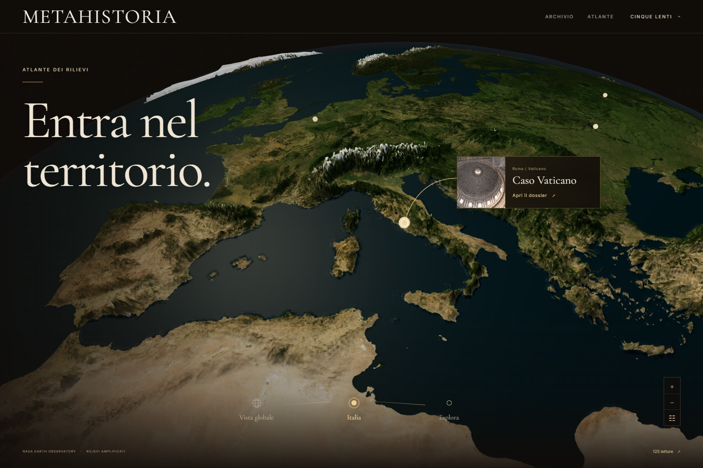

# MetaHistoria

Archivio editoriale interattivo dedicato a teologia, geopolitica e storia delle civiltà, con lettore a libro, carta deformabile e atlante tridimensionale dei rilievi.

**[Visita il sito](https://metahistoria-atlante-rilievi.fizzyrobin3.chatgpt.site)** · **[Apri l’atlante 3D](https://metahistoria-atlante-rilievi.fizzyrobin3.chatgpt.site/atlante-globo)**



## Avvio locale

Richiede Node.js 20.19 o successivo e npm.

```bash
npm ci
npm run dev
```

Aprire `http://127.0.0.1:5173`. Su Windows è disponibile anche `AVVIA-METAHISTORIA.cmd`, che usa la porta 4182.

```bash
npm run build
npm run preview
```

La compilazione esegue il controllo TypeScript e genera il sito statico in `dist/`. L’anteprima di produzione usa normalmente `http://127.0.0.1:4173`.

## Funzioni

- Home con archivio di documenti, animazioni GSAP e passaggio all’atlante durante lo scorrimento. Lo scroll inverso riporta alla carta.
- Lettore con pagine HTML, indice, collegamenti, numerazione nell’indirizzo, lettura continua, stampa e immagini ingrandibili. La sfogliatura usa una superficie Three.js deformabile.
- Atlante con immagini NASA, terreno in rilievo, vista globale, camera sull’Italia e selezione dei luoghi dei dossier. Si ruota trascinando; i pulsanti +/−, Alt + rotella e doppio clic controllano lo zoom.
- Indice ricercabile delle 125 letture, navigazione delle sezioni e collegamenti ai dossier.
- Layout mobile, comandi touch, rispetto della preferenza di movimento ridotto e accesso all’indice anche senza WebGL.

Percorsi principali: `/`, `/geopolitica-classica`, `/atlante-visuale` e `/atlante-globo`.

## Struttura

| Cartella | Contenuto |
| --- | --- |
| `src/components/` | Home, lettore, carta, atlante e navigazione |
| `src/lib/` | Routing, paginazione, geometria della carta, geografia e renderer Three.js |
| `src/content/` | Indice e documenti editoriali caricati su richiesta |
| `src/data/` | Dati e crediti delle immagini dell’archivio |
| `src/styles/` | Stili editoriali, libro e atlante dei rilievi |
| `public/media/` | Immagini d’archivio e texture terrestri con altimetria e crediti NASA |
| `public/atlante-globo/` | Componente dei confronti editoriali e licenze delle dipendenze |
| `globe-source/` | Sorgenti e dati del componente dei confronti, inclusi i luoghi dei dossier |
| `scripts/` | Preparazione delle immagini e delle risorse |
| `docs/` | Note di implementazione, verifiche e schermate |

React 19, TypeScript, Vite, GSAP e Three.js. Font e immagini necessari all’esecuzione sono inclusi nel progetto. Dipendenze, build generate e file temporanei si ricreano localmente.

## Distribuzione

Pubblicare il contenuto di `dist/` su un servizio di hosting statico. Il server deve restituire `index.html` per le rotte dell’applicazione che non corrispondono a un file, in modo da poter aprire direttamente articoli e atlante. I percorsi delle risorse sono relativi alla radice del dominio.

`.openai/hosting.json` conserva l’identità del sito Sites esistente e la configurazione per l’apertura diretta delle rotte. Il sito online viene aggiornato con una pubblicazione esplicita; un push su questo repository non lo aggiorna automaticamente.

## Immagini e rilievi

Le immagini dell’atlante provengono da [NASA Blue Marble Next Generation](https://science.nasa.gov/earth/earth-observatory/blue-marble-next-generation/base-map/) e dall’[altimetria NASA Earth Observatory / GEBCO](https://science.nasa.gov/earth/earth-observatory/blue-marble-next-generation/topography-bathymetry-maps/). I dettagli delle sorgenti e delle trasformazioni sono in `public/media/earth-relief/SOURCES.json`. Il rilievo è amplificato per la vista editoriale.

Crediti delle immagini d’archivio in `src/data/assets.json`; licenze del componente dei confronti in `public/atlante-globo/LICENSES.md` e `public/atlante-globo/licenses/`.

## Verifiche

La build e i controlli su selezione dei luoghi, collegamenti, ricerca, zoom, navigazione, transizione della home e gesti touch sono descritti in [Atlante dei rilievi](docs/ATLANTE-DEI-RILIEVI.md). I risultati sono in `docs/relief-qa.json`; i dettagli del lettore e della carta sono in [Carta e lettore](docs/CINEMATIC-PAPER-ATLAS.md). I controlli mobile documentati usano emulazione del browser.
